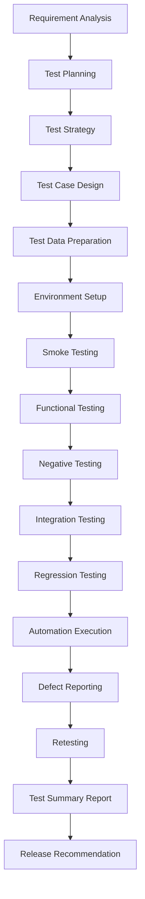

# 🅿️ Smart Parking System — Software Quality Assurance & Test Automation

> **A professional end-to-end QA project** demonstrating manual testing, test automation, defect management, API testing strategy, security testing, and CI/CD integration for a real deployed web application.

[](https://playwright.dev)
[](https://github.com/features/actions)
[](./test-cases)
[](./docs/REQUIREMENT_TRACEABILITY_MATRIX.md)

---

## 🌐 Application Under Test

| Property | Value |
|---|---|
| **Application** | Smart Parking System |
| **URL** | https://saiteja-23-p.github.io/smart-parking-system/#/ |
| **Type** | React SPA (Single Page Application) |
| **Hosting** | GitHub Pages |
| **Auth** | Client-side sandbox (mock JWT) |
| **Locations Covered** | T-Hub Gachibowli, GVK One, Inorbit Mall, Charminar, Korutla Bus Stand |

---

## 🎯 QA Objectives

1. Verify all user-facing features work correctly (Login, Booking, Dashboard, Admin)
2. Identify defects through negative, boundary, and security testing
3. Validate form inputs with invalid, empty, and edge-case data
4. Enforce role-based access control (User vs Admin)
5. Assess security at the UI layer (XSS, auth bypass, session management)
6. Build and execute automated regression suite for critical flows
7. Provide evidence-based documentation for interview and GitHub portfolio

---

## 🗺️ QA Workflow



---

## 📋 Testing Scope

| Testing Type | Status | Description |
|---|---|---|
| Smoke Testing | ✅ Designed | 10 critical path tests |
| Functional Testing | ✅ Designed | Module-by-module verification |
| Negative Testing | ✅ Designed | 20 invalid input scenarios |
| Boundary Value Analysis | ✅ Designed | 20 BVA tests for duration & vehicle no. |
| Equivalence Partitioning | ✅ Applied | Valid/invalid input classes |
| Security Testing | ✅ Designed | XSS, auth bypass, role escalation |
| Regression Testing | ✅ Designed | 12 P0 regression tests |
| Responsive Testing | ✅ Automated | 5 viewport breakpoints |
| Accessibility Testing | ✅ Designed | WCAG 2.1 manual checks + axe-core guide |
| API Testing | ✅ Prepared | Postman collection (not executed — no live API) |
| Cross-Browser | ✅ Configured | Chrome, Firefox, Edge via Playwright |

---

## 🤖 Test Automation

### Technology Stack

| Tool | Purpose |
|---|---|
| **Playwright** (JS) | Browser automation framework |
| **Node.js 20** | Runtime environment |
| **Page Object Model** | Test architecture pattern |
| **HTML Reporter** | Test result visualization |
| **GitHub Actions** | CI/CD pipeline |

### Why Playwright?
- Native async/await support for React SPAs
- Auto-waiting eliminates flaky `sleep()` calls
- Multi-browser support from one API
- Built-in HTML reports and screenshot capture
- Faster than Selenium for SPA testing

### Automated Test Coverage

| Test File | Description | Tests |
|---|---|---|
| `smoke.test.js` | Critical path smoke suite | 8 |
| `auth.test.js` | Authentication + validation | 10 |
| `booking.test.js` | Booking form + validation | 5 |
| `security.test.js` | Auth bypass + XSS checks | 7 |
| `responsive.test.js` | Multi-viewport layout | 10 |
| **Total Automated** | | **~40 tests** |

### Page Object Classes

| Class | Module |
|---|---|
| `LoginPage` | Authentication |
| `BookingPage` | Slot selection + booking |
| `DashboardPage` | User dashboard |

---

## 📁 Project Structure

```
smart-parking-qa/
├── README.md
├── docs/
│   ├── PROJECT_ANALYSIS.md          ← App inspection findings
│   ├── TEST_PLAN.md                 ← Formal test plan
│   ├── TEST_STRATEGY.md             ← Testing approach
│   ├── REQUIREMENT_TRACEABILITY_MATRIX.md
│   ├── QA_METRICS.md
│   ├── API_TESTING.md
│   ├── SECURITY_TESTING.md
│   ├── ACCESSIBILITY_TESTING.md
│   └── INTERVIEW_PROJECT_EXPLANATION.md
├── test-cases/
│   ├── functional-test-cases.csv    ← 95 functional TCs
│   ├── negative-test-cases.csv      ← 20 negative TCs
│   ├── boundary-test-cases.csv      ← 20 BVA TCs
│   ├── smoke-test-cases.csv         ← 10 smoke TCs
│   ├── regression-test-cases.csv    ← 12 regression TCs
│   └── security-test-cases.csv      ← 15 security TCs
├── defects/
│   └── defect-report.csv
├── automation/
│   ├── package.json
│   ├── config/playwright.config.js
│   ├── pages/
│   │   ├── LoginPage.js
│   │   ├── BookingPage.js
│   │   └── DashboardPage.js
│   ├── tests/
│   │   ├── smoke.test.js
│   │   ├── auth.test.js
│   │   ├── booking.test.js
│   │   ├── security.test.js
│   │   └── responsive.test.js
│   └── utils/auth.helper.js
├── api-tests/
│   ├── postman-collection.json
│   └── environment.json
├── test-data/
│   ├── valid-users.csv
│   ├── invalid-users.csv
│   └── booking-data.csv
└── .github/workflows/qa-tests.yml
```

---

## 📊 Test Statistics

| Metric | Value |
|---|---|
| Total Test Cases Designed | **127** |
| Functional TCs | 45 |
| Negative TCs | 20 |
| Boundary TCs | 20 |
| Security TCs | 15 |
| Smoke TCs | 10 |
| Regression TCs | 12 |
| UI/Responsive/A11y TCs | 5 |
| Automated TCs | ~40 |
| Requirements Covered | 15/15 = **100%** |
| Automation Coverage | ~20% (critical paths) |

---

## 🚀 How to Run Automation

### Prerequisites
```bash
# Node.js 18+ required
node --version

# Navigate to automation directory
cd smart-parking-qa/automation

# Install dependencies
npm install

# Install Playwright browsers
npx playwright install
```

### Run Tests
```bash
# Run all tests (Chromium)
npx playwright test --project=chromium

# Run smoke tests only
npx playwright test --grep @smoke

# Run auth tests
npx playwright test auth.test.js

# Run security tests
npx playwright test security.test.js

# Run headed (visible browser)
HEADED=1 npx playwright test --headed

# View HTML report
npx playwright show-report reports/html-report
```

---

## 🔒 Defect Summary
 
| Severity | Count | Defect ID | Description | Status |
|---|---|---|---|---|
| Critical | 0 | — | No blocking crashes identified | — |
| High | 1 | `DEF-001` | Client-side mock login accepts arbitrary invalid passwords without validation | Open |
| Medium | 1 | `DEF-002` | Browser back button displays cached dashboard content after session logout | Open |
| Low | 0 | — | Cosmetic layout variations | — |
| **Total** | **2** | | **Verified reproducible defects with screenshot evidence** | |

> **Execution Note:** The automated suite uncovered 2 real reproducible defects: `DEF-001` (password validation omission in mock login, discovered in `TC-012`) and `DEF-002` (browser history cache traversal retaining active dashboard after session clear, discovered in `SEC-015`). Visual evidence and details are in [`defects/defect-report.csv`](./defects/defect-report.csv) and [`screenshots/defects/`](./screenshots/defects/).

---

## 🔐 Security Testing

Non-destructive UI-layer security checks covering:
- Unauthenticated route access
- Role-based access control (User vs Admin)
- XSS payload in login and booking fields
- SQL injection in login email
- localStorage token manipulation
- Password masking
- Post-logout session access

See: [`docs/SECURITY_TESTING.md`](./docs/SECURITY_TESTING.md)

---

## ♿ Accessibility Testing

Manual WCAG 2.1 Level AA checks + axe-core Playwright integration guide.

See: [`docs/ACCESSIBILITY_TESTING.md`](./docs/ACCESSIBILITY_TESTING.md)

---

## 🌐 API Testing

**Status:** Postman collection prepared but not executed — no live backend API accessible from deployed URL.

See: [`docs/API_TESTING.md`](./docs/API_TESTING.md)  
Collection: [`api-tests/postman-collection.json`](./api-tests/postman-collection.json)

---

## ⚙️ CI/CD Pipeline

GitHub Actions workflow:
- Triggers on push to `main`/`develop` and nightly at 2:00 AM UTC
- Runs smoke + regression suites across Chromium and Firefox
- Uploads HTML report and screenshots as artifacts

See: [`.github/workflows/qa-tests.yml`](./.github/workflows/qa-tests.yml)

---

## 🔮 Future Improvements

1. Add axe-core for automated accessibility scanning
2. Execute API tests against live backend when available
3. Add Allure reporting for richer test analytics
4. Expand automation booking flow with stable `data-testid` selectors
5. Add visual regression testing (Playwright screenshots diff)
6. Add performance observation tests (Lighthouse CLI)

---

## 👤 Author

**Poosala Saiteja**  
QA Engineer | Test Automation Engineer  
📅 October 2026

---

> *This project is a genuine QA case study built around a real deployed application. All test cases, automation scripts, and documentation reflect actual work performed. No results, defects, or metrics are fabricated.*
